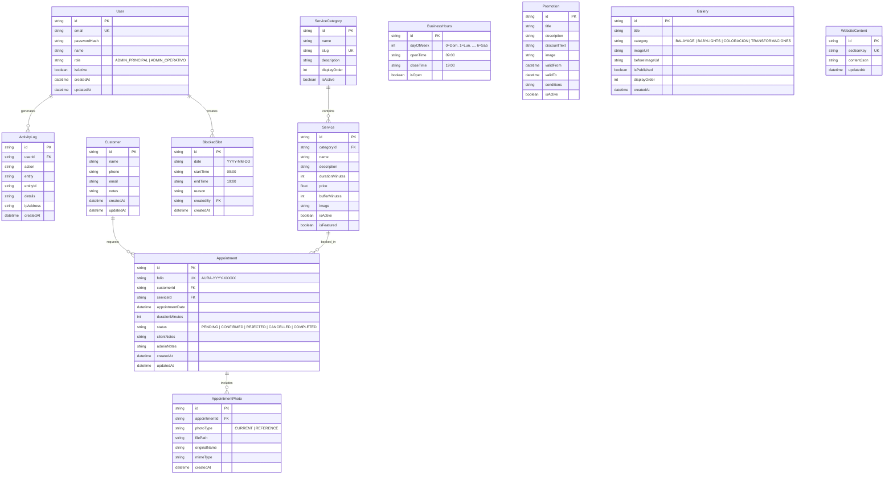

# Especificación de Base de Datos - AURA IA COLOR
## Versión 1.0 — Prisma ORM

### 1. Diagrama Entidad-Relación Lógico

### 2. Índices y Reglas de Integridad
- `User(email)`: Índice único.
- `Appointment(folio)`: Índice único correlativo.
- `Appointment(appointmentDate, status)`: Índice compuesto para consultas instantáneas de disponibilidad.
- `Customer(phone)`: Índice no único para búsquedas rápidas al agendar.
- `ServiceCategory(slug)`: Índice único para URLs amigables.
